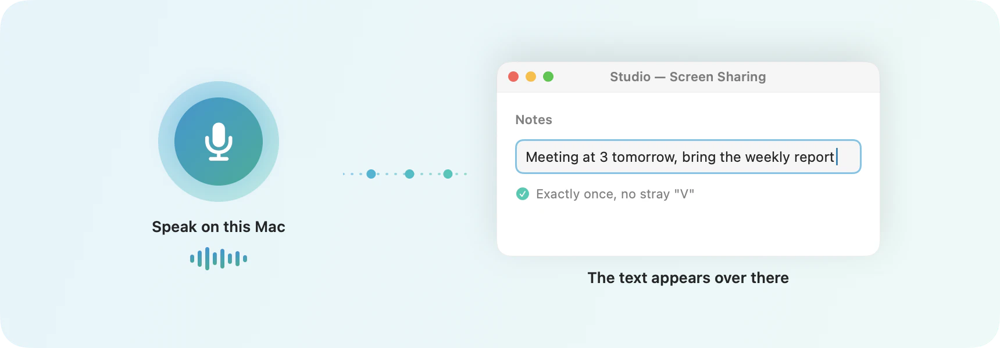
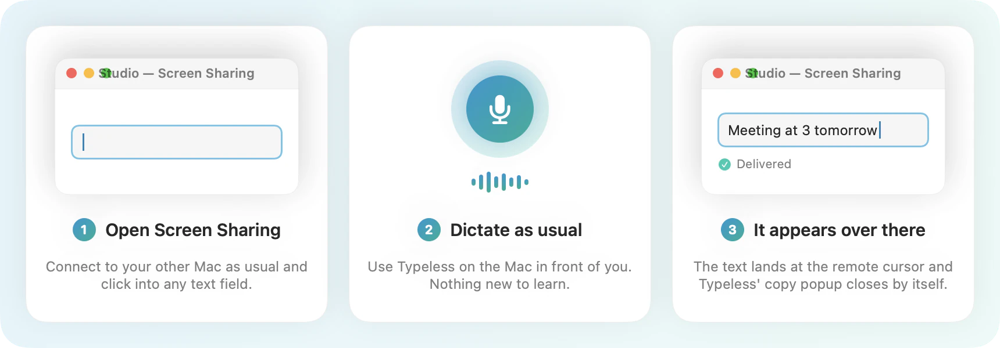
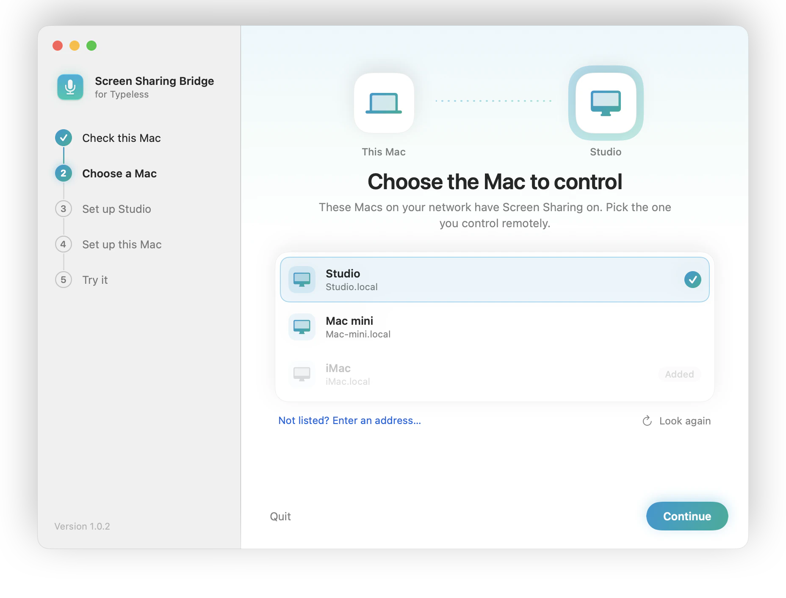
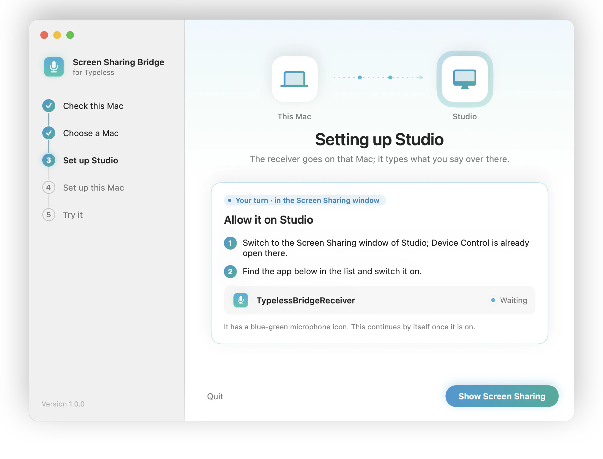
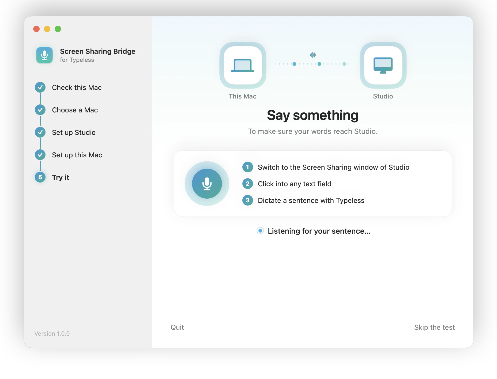
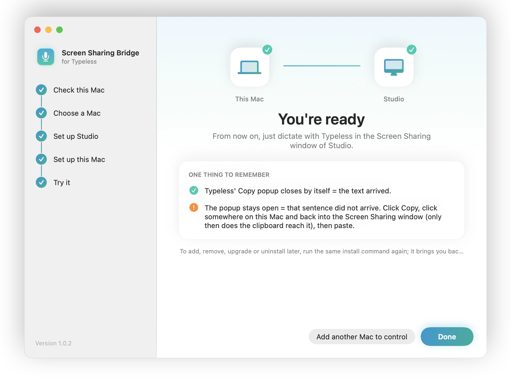

<p align="center">
  
</p>

<h1 align="center">Screen Sharing Bridge for Typeless</h1>

<p align="center">
  <b>Control another Mac with Screen Sharing, dictate with Typeless as usual, and the words land on that Mac.</b>
</p>

<p align="center">
  English · <a href="README.md">中文</a>
</p>

<p align="center">
  <picture>
    <source media="(prefers-color-scheme: dark)" srcset="docs/images/hero-en-dark.webp">
    
  </picture>
</p>

## Why

When you control another Mac with Apple's Screen Sharing, Typeless can only hand its text to the
Mac in front of you, and the text field over there never gets it. You end up with a stray "V" on
the remote Mac, or the text stuck in Typeless' copy popup for you to copy and paste by hand.

With the bridge installed, whenever a Screen Sharing window is in front, what you say appears
**at the cursor on that Mac**, exactly once and without a stray "V".

## What it is like

<p align="center">
  <picture>
    <source media="(prefers-color-scheme: dark)" srcset="docs/images/how-en-dark.webp">
    
  </picture>
</p>

Nothing new to learn:

- **Screen Sharing in front:** dictate with Typeless as usual. The text appears at the remote
  cursor and Typeless' copy popup closes by itself.
- **If the popup stays open, that sentence did not arrive:** click Copy and paste it yourself,
  just as Typeless asks you to on a single Mac.
- **Screen Sharing not in front:** nothing changes; the bridge stays out of the way.

## Install

Only on **the Mac you talk to** (the one with Typeless): open Terminal and paste this line:

```bash
curl -fsSL https://raw.githubusercontent.com/GordonWang1878/typeless-screen-sharing-bridge/main/install.sh | bash
```

A setup window opens (you can close Terminal then) and walks you through it:

<table>
  <tr>
    <td width="50%" align="center">
      <picture>
        <source media="(prefers-color-scheme: dark)" srcset="docs/images/setup-choose-en-dark.webp">
        
      </picture>
      <br><b>① Choose the Mac to control</b><br>
      <sub>Macs with Screen Sharing on your network are listed. Type that Mac's password once and the receiver is installed there for you.</sub>
    </td>
    <td width="50%" align="center">
      <picture>
        <source media="(prefers-color-scheme: dark)" srcset="docs/images/setup-allow-en-dark.webp">
        
      </picture>
      <br><b>② Turn on the switches</b><br>
      <sub>Which Mac, which switch: spelled out. Each one ticks the moment you turn it on.</sub>
    </td>
  </tr>
  <tr>
    <td width="50%" align="center">
      <picture>
        <source media="(prefers-color-scheme: dark)" srcset="docs/images/setup-try-en-dark.webp">
        
      </picture>
      <br><b>③ Say something</b><br>
      <sub>Dictate a sentence in the Screen Sharing window to confirm it really arrives.</sub>
    </td>
    <td width="50%" align="center">
      <picture>
        <source media="(prefers-color-scheme: dark)" srcset="docs/images/setup-done-en-dark.webp">
        
      </picture>
      <br><b>④ Done</b><br>
      <sub>A little "ding", and from then on you just talk.</sub>
    </td>
  </tr>
</table>

- Nothing to install by hand on the Mac you control.
- Each run adds one Mac. To control another one, remove one, upgrade or uninstall, run the same
  line again.
- The first run spends about 30 seconds preparing the setup window on your Mac; Terminal shows
  the progress.
- You can also let your coding agent (Claude Code, Codex, …) do it: give it [AGENTS.md](AGENTS.md).

## Requirements

- macOS and Typeless (signed in on the Mac you talk to)
- Apple's built-in Screen Sharing to control the other Macs
- All Macs on the same local network; the Macs you control need Remote Login on (the setup
  window tells you how)

## FAQ

**Is it safe?** Text only travels over encrypted SSH between your own Macs, never through a third
party, and is never logged. The connection uses a dedicated key; the setup checks the other Mac's
name and remembers its identity, so a different machine is refused later.

**Is my password stored?** No. The other Mac's password is used for the first login only; a
dedicated key is used after that.

**Why do I have to turn the switches on myself?** macOS only lets you, not a program, allow apps
to press keys and read window information.

**One Mac is not recognised?** The bridge recognises a Mac by the name of its Screen Sharing
connection, which is that Mac's name. If you renamed a saved connection, rename it back.

**Macs on another network?** If the Macs can reach each other (for example with Tailscale), choose
"Enter an address" in the setup window and type the other Mac's address. Not specifically tested
yet.

**How do I uninstall?** Run the install line again and choose "Uninstall…" in the window.

## More

- [How it works, logs and known limitations](docs/details.md)
- Manual install and development: see the header of `install/typeless-bridge.sh`; run the tests
  with `python3 -m unittest discover -s tests`
- [Changelog](CHANGELOG.md)

## License

[MIT](LICENSE). Not affiliated with Typeless.
