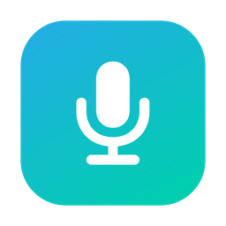
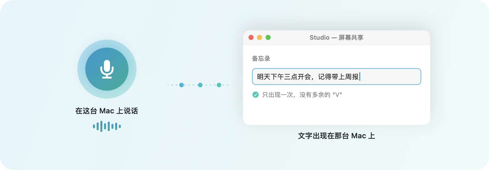
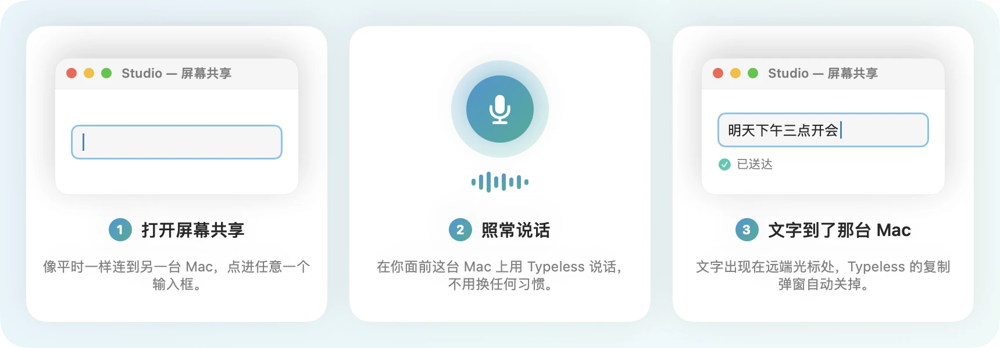
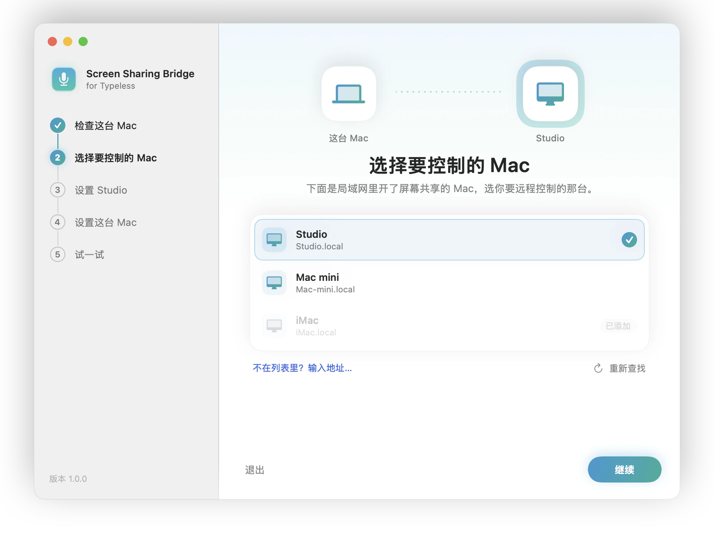
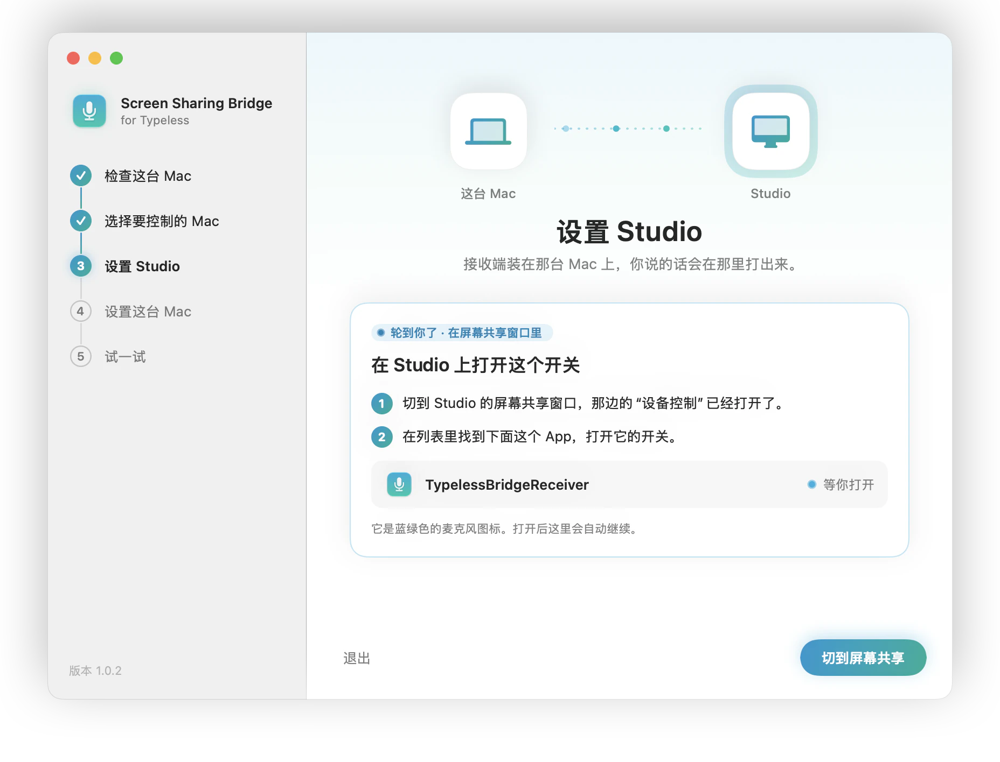
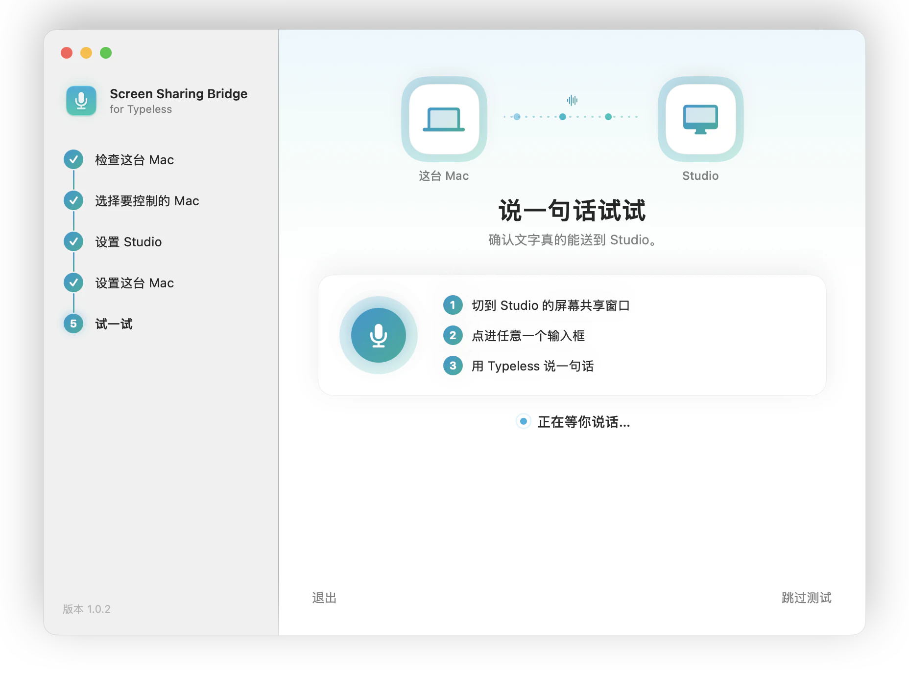
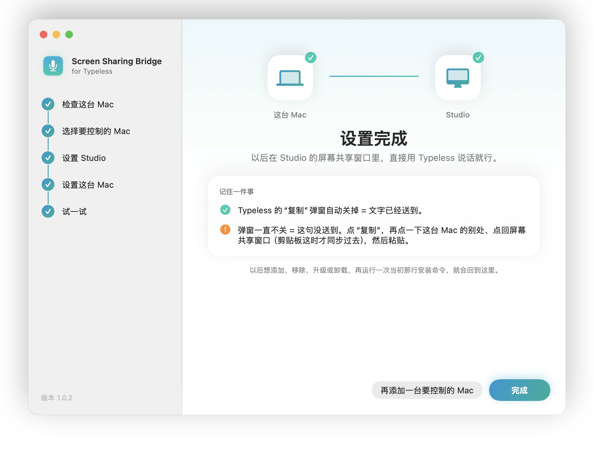

<p align="center">
  
</p>

<h1 align="center">Screen Sharing Bridge for Typeless</h1>

<p align="center">
  <b>用屏幕共享控制另一台 Mac 时，照常用 Typeless 说话，文字就写进那台 Mac。</b>
</p>

<p align="center">
  <a href="README.en.md">English</a> · 中文
</p>

<p align="center">
  <picture>
    <source media="(prefers-color-scheme: dark)" srcset="docs/images/hero-zh-dark.webp">
    
  </picture>
</p>

## 为什么需要它

用 macOS 自带的"屏幕共享"控制另一台 Mac 时，Typeless 只能把文字交给你面前这台 Mac，那边的输入框收不到。结果往往是那边多出一个 "V"，或者文字留在 Typeless 的复制弹窗里，要你自己复制、粘贴。

装上这个桥接之后，只要前台是屏幕共享窗口，你说的话就会直接出现在**那台 Mac 的光标处**，只出现一次，也没有多余的 "V"。

## 用起来是什么样

<p align="center">
  <picture>
    <source media="(prefers-color-scheme: dark)" srcset="docs/images/how-zh-dark.webp">
    
  </picture>
</p>

不需要学任何新东西：

- **前台是屏幕共享窗口**：照常用 Typeless 听写，文字出现在远端光标处，Typeless 的复制弹窗会自动关掉。
- **如果弹窗没有自动关掉，就说明这句没送到**：点"复制"后手动粘贴即可，和你平时在本机用 Typeless 一样。
- **前台不是屏幕共享**：一切照旧，桥接不参与。

## 安装

只在**你说话的那台 Mac**（装了 Typeless 的那台）上打开"终端"，粘贴这一行：

```bash
curl -fsSL https://raw.githubusercontent.com/GordonWang1878/typeless-screen-sharing-bridge/main/install.sh | bash
```

一个安装窗口会打开（终端随后就可以关掉了），一步步带你做完：

<table>
  <tr>
    <td width="50%" align="center">
      <picture>
        <source media="(prefers-color-scheme: dark)" srcset="docs/images/setup-choose-zh-dark.webp">
        
      </picture>
      <br><b>① 选一台要控制的 Mac</b><br>
      <sub>自动列出局域网里开了屏幕共享的 Mac；输入一次那台 Mac 的开机密码，接收端就自动装过去。</sub>
    </td>
    <td width="50%" align="center">
      <picture>
        <source media="(prefers-color-scheme: dark)" srcset="docs/images/setup-allow-zh-dark.webp">
        
      </picture>
      <br><b>② 打开权限开关</b><br>
      <sub>在哪台 Mac 上、打开哪个开关，都写得清清楚楚；开关一打开，这里就自动打勾。</sub>
    </td>
  </tr>
  <tr>
    <td width="50%" align="center">
      <picture>
        <source media="(prefers-color-scheme: dark)" srcset="docs/images/setup-try-zh-dark.webp">
        
      </picture>
      <br><b>③ 说一句话试试</b><br>
      <sub>在屏幕共享窗口里说一句，确认文字真的送到了。</sub>
    </td>
    <td width="50%" align="center">
      <picture>
        <source media="(prefers-color-scheme: dark)" srcset="docs/images/setup-done-zh-dark.webp">
        
      </picture>
      <br><b>④ 完成</b><br>
      <sub>"叮"的一声，以后直接说话就行。</sub>
    </td>
  </tr>
</table>

- 被控制的那台 Mac 上不需要你手动安装任何东西。
- 每运行一次添加一台 Mac。想再控制一台、移除、升级或卸载，再运行同一行命令即可。
- 第一次运行时，安装窗口要在你的 Mac 上准备大约 30 秒，终端里会显示进度。
- 也可以让你的编程助手（Claude Code、Codex 等）帮你装，把 [AGENTS.md](AGENTS.md) 交给它就行。

## 需要

- macOS，以及 Typeless（在你说话的那台 Mac 上已登录）
- 用 macOS 自带的"屏幕共享"控制其他 Mac
- 所有 Mac 在同一个局域网里；被控制的 Mac 需要打开"远程登录"（安装窗口会告诉你怎么开）

## 常见问题

**安全吗？** 文字只经过你自己几台 Mac 之间的 SSH 加密连接，不经过任何第三方服务器，也不会写进日志。连接使用专用密钥；向导会核对对方 Mac 的名字，并记住它的身份，以后换了机器就连不上，防止连错。

**密码会被保存吗？** 不会。那台 Mac 的开机密码只用于第一次登录，之后改用专用密钥。

**为什么要我手动打开开关？** macOS 规定，模拟按键和读取窗口信息的权限只能由用户本人授予，任何程序都不能代劳。

**某台 Mac 认不出来？** 桥接按屏幕共享连接的名字（即对方 Mac 的名字）来识别。如果你把保存的连接改成了别的名字，改回对方 Mac 的名字即可。

**不在同一个局域网的 Mac 能用吗？** 只要两台 Mac 能互相连上（比如用 Tailscale 这类组网工具），在安装窗口里选"输入地址"，填对方的地址即可。这类场景还没有专门测试过。

**怎么卸载？** 再运行安装命令，在窗口里选"全部卸载…"。

## 更多

- [工作原理、日志与已知限制](docs/details.md)
- 手动安装与开发：见 `install/typeless-bridge.sh` 文件开头的说明；测试运行 `python3 -m unittest discover -s tests`
- [更新记录](CHANGELOG.md)

## 许可证

[MIT](LICENSE)。本项目与 Typeless 官方无关。
